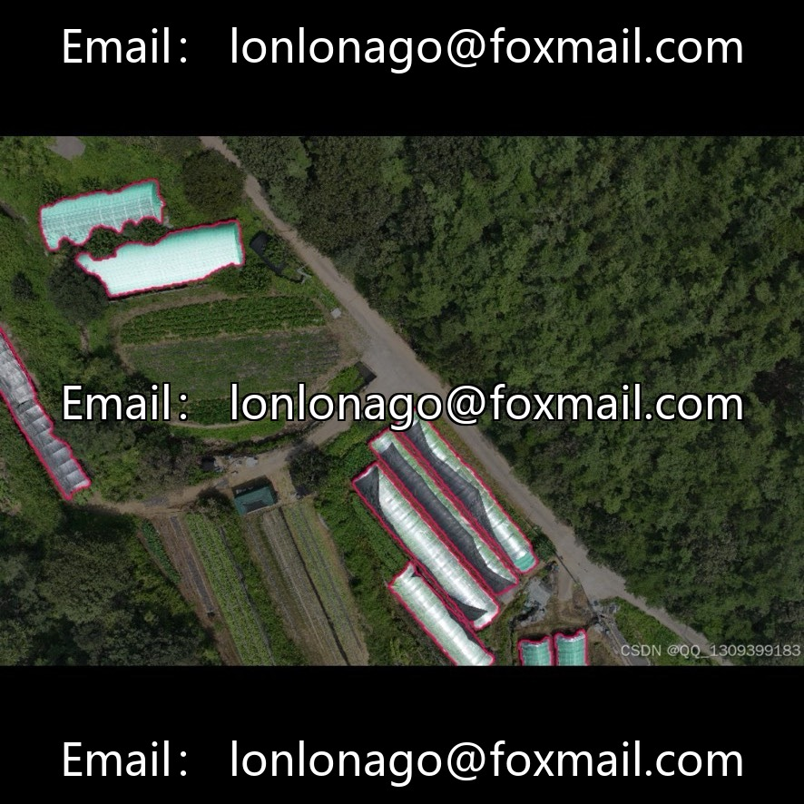
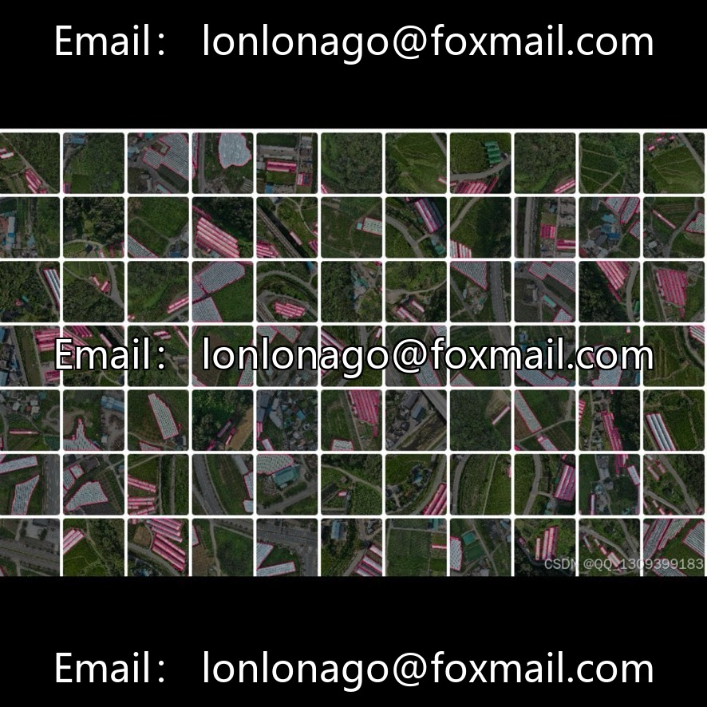
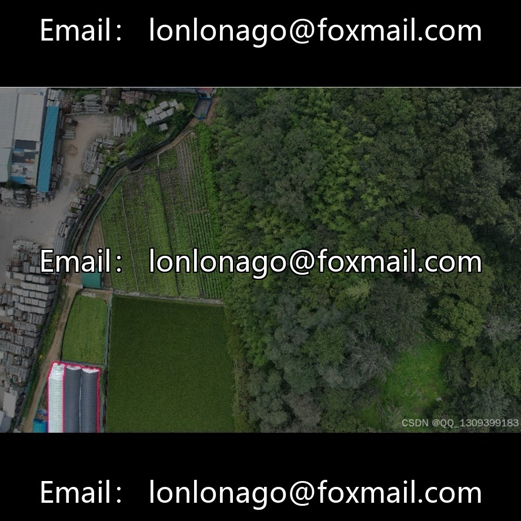
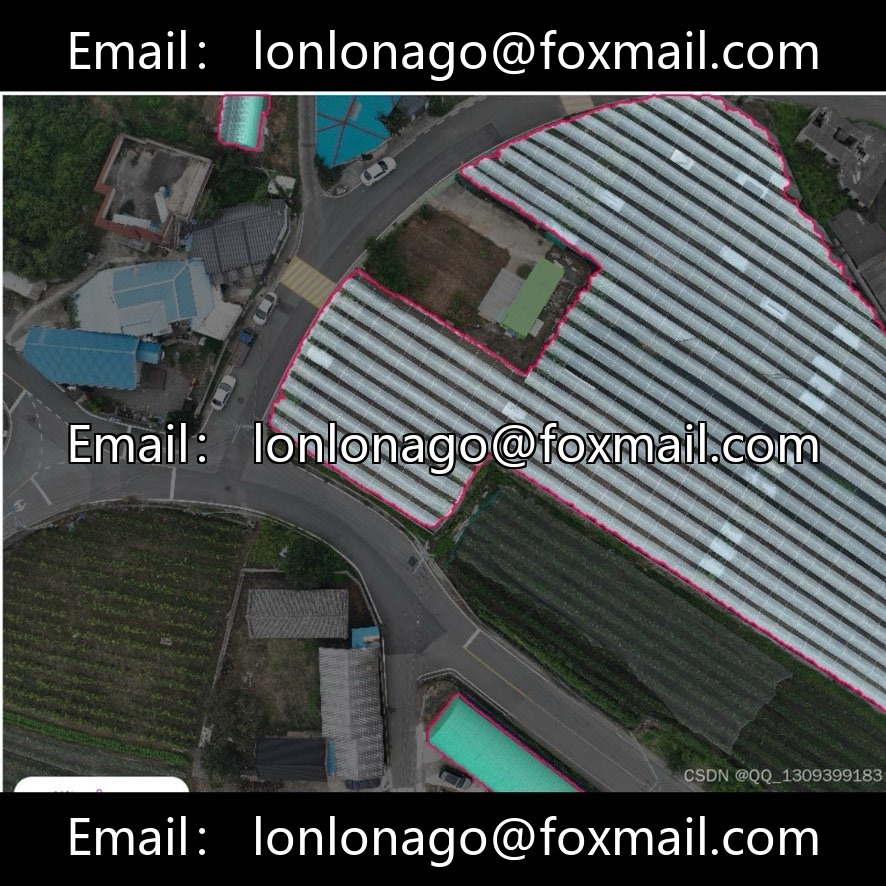
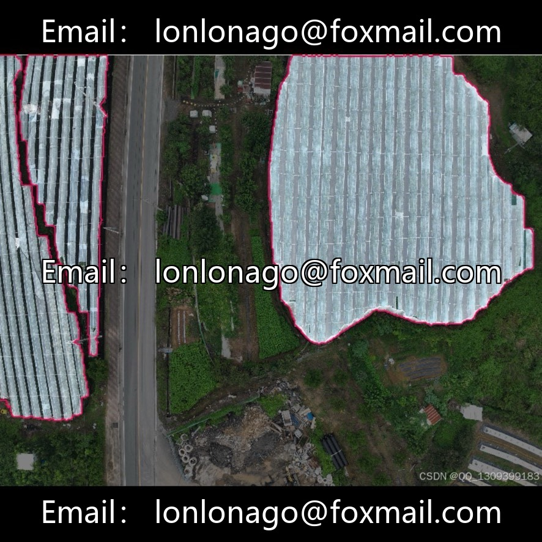

# UAV aerial photography intelligent farm greenhouse and greenhouse example segmentation dataset, 10081th issue

## Body

UAV aerial photography intelligent farm greenhouse and greenhouse example segmentation dataset, 10081th issue

The dataset consists of 3,000 drone aerial imagery, accompanied by one pre-trained instance segmentation model (mAP@0.5=91.8%), suitable for agricultural monitoring, structural inspection, algorithm research, and scientific teaching scenarios. It includes pixel-level contour labeling, ready to use out of the box, and supports rapid integration into agricultural monitoring systems.

Virtual materials, once sold, are non-refundable.
Interested friends, click "I want" to proceed.

## Images

## Payment

Here is a pay link on Stripe ( https://buy.stripe.com/3cs8yP7sY87d0vu9AB ). Please contact me lonlonago@foxmail.com after funding $89, and I will send you a complete data files , thank you!

